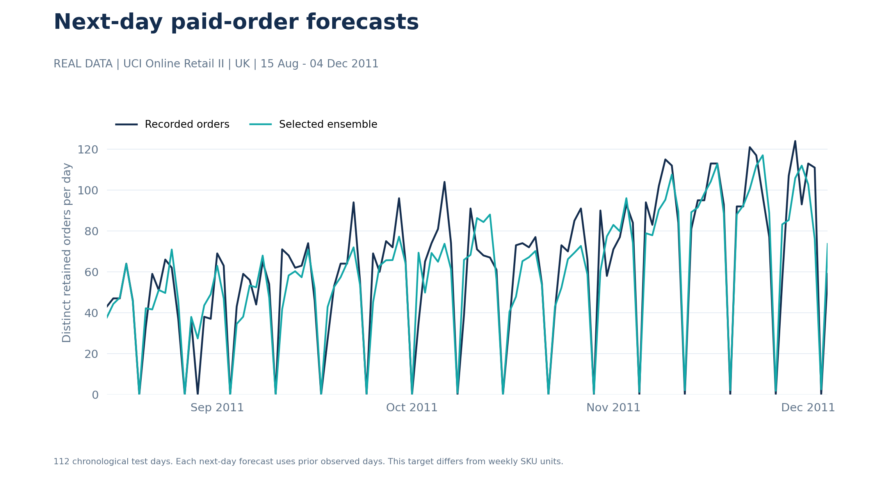
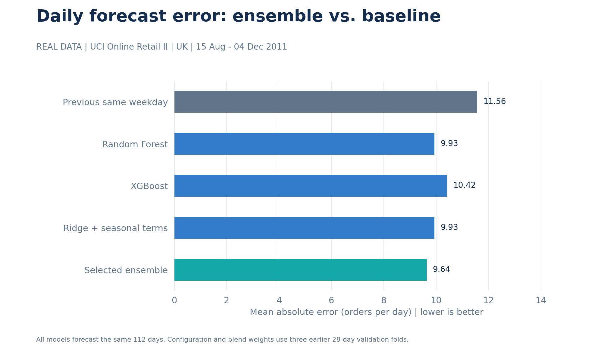
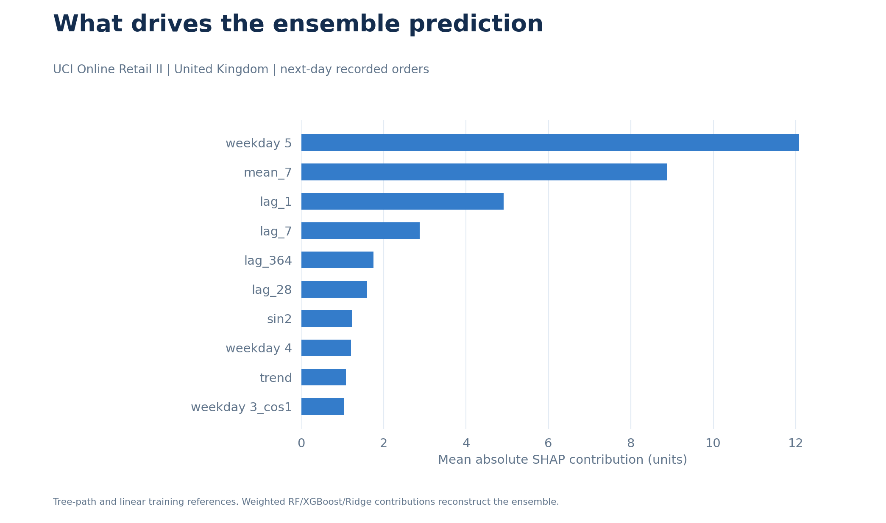
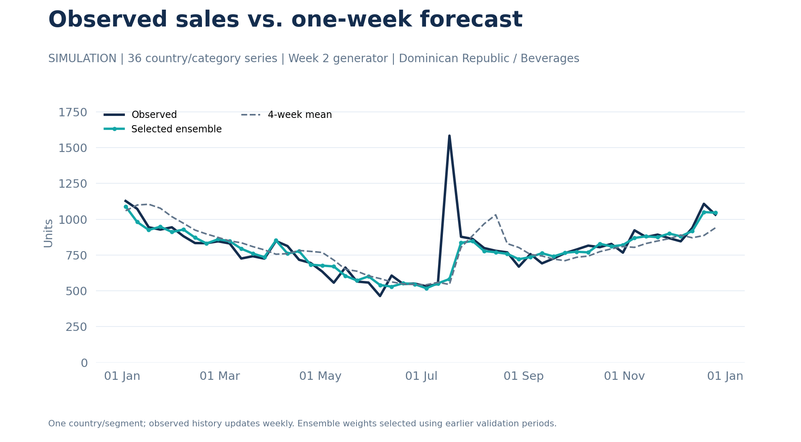
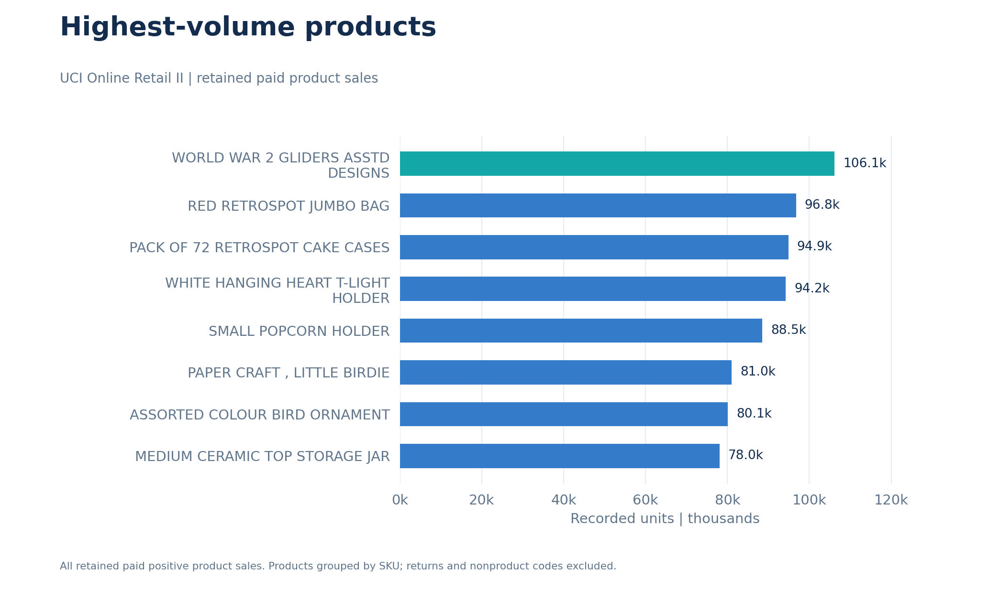
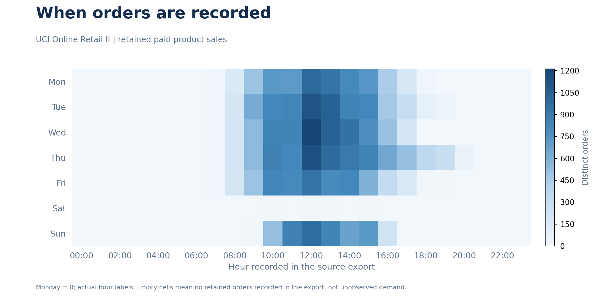

# Market Insights & Forecasting

**Retail analytics and forecasting, built by Gustavo.**

I use historical transactions to answer a practical question: **how many paid orders should a fulfilment team expect tomorrow?** I also test weekly SKU forecasts and apply the methods from my four-week NielsenIQ-inspired exercises: data quality, forecasting, SHAP, pricing and NLP.

The transaction analysis and daily forecasts use **real UCI Online Retail II data**. The Nielsen demand, pricing and feedback exercises are **independent simulations**. Their results stay separate.

Python · SQL / DuckDB · pandas · scikit-learn · XGBoost · Ridge · SHAP · SciPy · Matplotlib

## Daily order forecasting — real transactions

**Ensemble R²: 0.844 · MAE: 9.64 orders/day · WAPE: 15.76%.**

Target: distinct paid UK order IDs recorded each day. This supports a historical workload-planning exercise. It is a different target from units sold for an individual SKU.

I tested **112 chronological days, 15 August–4 December 2011**. Each next-day prediction uses already observed previous days. Configuration and weights were chosen using **three earlier 28-day validation folds**, entirely before the test. Training-only imputation, weekday encoding, annual calendar terms and prior order counts feed the models.

| Model | MAE ↓ | R² | WAPE ↓ |
|---|---:|---:|---:|
| Same-weekday baseline | 11.56 | 0.736 | 18.91% |
| Random Forest | 9.93 | 0.833 | 16.24% |
| XGBoost | 10.42 | 0.827 | 17.03% |
| Ridge | 9.93 | 0.845 | 16.23% |
| Ensemble | 9.64 | 0.844 | 15.76% |

MAE is measured in orders per day. **R² is a regression score, not the percentage of predictions that are correct.** The ensemble meets the R² ≥ 0.80 research target and reduces MAE by 16.6% against the same-weekday baseline. Its validation-selected weights are **80% RF / 10% XGBoost / 10% Ridge**. Ridge has slightly higher final R²; the ensemble has lower final MAE. I keep both results visible.





Calendar patterns contribute to the pooled score; performance differs by weekday. [Scores by weekday](reports/operations/metrics/scores_by_weekday.csv), [predictions](reports/operations/metrics/forecast_predictions.csv), [validation](reports/operations/metrics/temporal_backtest.csv) and the [complete search](reports/operations/metrics/ensemble_selection.csv) are exported. Constant-target R² is undefined, rather than reported as a perfect score.

SHAP contributions reconstruct the weighted model. Any correction used to keep component forecasts nonnegative is recorded separately in the [additivity audit](reports/operations/metrics/shap_additivity.csv).



This is historical research on one retailer, not a live service or a measured staffing benefit.

## Weekly demand lab — Nielsen-inspired simulation

I preserved the original generator: **3,744 rows, 104 weeks, 36 country/category series, seed 42**. Planned promotions, holidays and market indices are assumed available before prediction.

The validation-selected **10% RF / 30% XGBoost / 60% Ridge ensemble** achieves **R² 0.936, MAE 30.75 units and WAPE 6.37%** on the 2022 holdout. The validation-selected four-week mean has MAE 47.97. The generator was not altered to meet the score target.



[Full model comparison](reports/demo/metrics/forecast_scores.csv) · [Scores for each country/category](reports/demo/metrics/forecast_by_series.csv). The median per-series R² is approximately 0.795, lower than pooled R²; a high global score does not establish uniform performance. Pure Ridge has the best final test MAE here, while the blend was selected using earlier validation. This rerun of an already inspected historical holdout requires independent future confirmation.

## What still fails: weekly SKU units and template NLP

**Real SKU forecasts:** I freeze 12 SKU identities before the first validation origin, then compare the same 104-week panel and final 16 weeks. The ensemble has **R² 0.252 and MAE 390.17 units**, while the validation-selected 13-week mean has MAE 304.61. This task **does not meet the R² target** and does not justify choosing the ensemble. [Results](reports/metrics/forecast_scores.csv).

Unusually large transactions, variable sales and absent inventory/promotion records limit the SKU task. Zero retained sales do not identify a stockout or zero underlying demand. Fixing the cohort before validation changes its membership from the first revision, so the old and new SKU scores are not a like-for-like improvement claim.

**NLP:** word/character TF-IDF improves unseen-template accuracy from 19.7% to 29.3%, but remains unsuitable for real reviews. Random-split accuracy is 89.2% for this model. I include a majority baseline and class F1, preserve negation, and prevent template overlap. The 650 generated bilingual texts still need a real human-labelled replacement before claiming customer-sentiment capability. [Diagnostic results](reports/metrics/sentiment_simulation.csv).

## Data quality and pricing

The UCI workbook contains **1,067,371 lines** from a UK online giftware retailer, December 2009–December 2011, priced in **GBP**. The cleaning audit retains **1,003,214 positive paid product lines**, with every exclusion counted. I audit duplicates, cancellations, invalid/nonfinite values, product codes, missing IDs and calendar coverage. These figures describe retained positive sales, not net revenue or profit.





The **pricing simulation** contains 800 independent units, an 8% discount and assumed costs. Welch difference intervals and Holm correction distinguish revenue, volume and contribution margin; the run does not establish a margin increase. Shared country/category names do not justify a customer-level merge across these datasets.


## Project structure

| Path | Purpose |
|---|---|
| data/raw/ · data/processed/ | Verified public input and recreated panels; large contents ignored by Git |
| data/samples/ | Attributed UCI excerpt and the original small demo |
| notebooks/ | Four explained analyses: quality, forecasting, pricing and NLP |
| src/market_insights/ | Shared Python modules, including daily operations forecasting |
| sql/ | Five analytical queries |
| reports/operations/ | Real daily-order forecasts, validation, scores and SHAP |
| reports/demo/ | Separately labelled Nielsen-inspired demand simulation |
| reports/metrics/ · reports/figures/ | SKU research, quality, SQL, pricing and NLP diagnostics |
| docs/ | Data/model cards, usage, decisions and the critical review |
| tests/ · .github/workflows/ | Contract, leakage, model-selection and execution checks |
| .devcontainer/ | Codespaces setup |

## Run in Codespaces

Open **Code → Codespaces → Create codespace**. The dev container installs notebook and explanation dependencies. Run:

```bash
python main.py --source real --explain
python -m pytest
```

Real mode runs daily operations forecasting, SKU research and the independent pricing/NLP diagnostics. To reproduce only the demand simulation and diagnostics without downloading UCI:

```bash
python main.py --source demo --explain
```

For another Python environment, install from the repository root:

```bash
python -m pip install -r requirements-dev.txt
```

[Usage / Databricks notes](docs/usage.md) · [Data card](docs/data_card.md) · [Model cards](docs/model_cards.md) · [Critical review](docs/critical_review.md).

Both full pipelines and SHAP were executed. Source/cache hashes, package versions, dates, selection results and target checks are saved in [run.json](reports/metrics/run.json). Tests cover future-target invariance, distinct-order counts, weighted predictions, nonnegative corrections, calendar/quality contracts, SQL and pipeline execution.

**Attribution:** Daqing Chen, *Online Retail II*, UCI Machine Learning Repository, [DOI 10.24432/C5CG6D](https://doi.org/10.24432/C5CG6D). Data/excerpt: [CC BY 4.0](https://creativecommons.org/licenses/by/4.0/). Code: [MIT](LICENSE).

[GitHub profile](https://github.com/gusbakers) · Master's in Data Science
