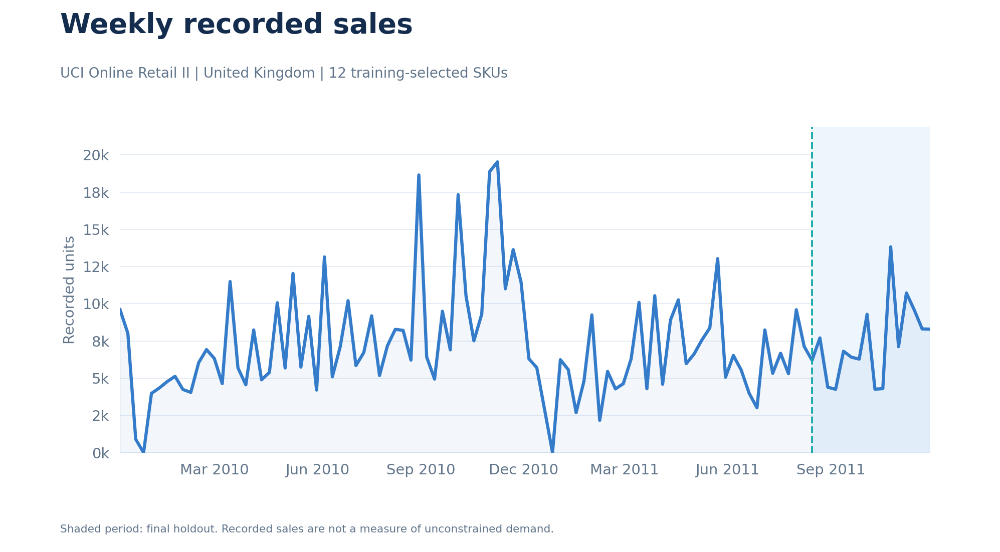
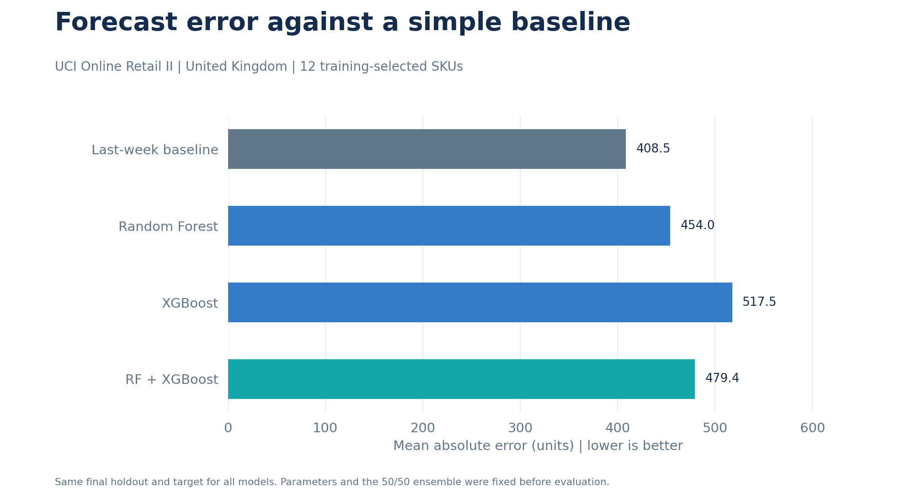
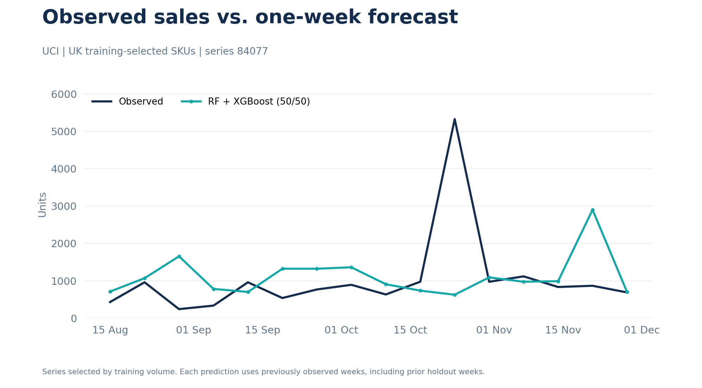
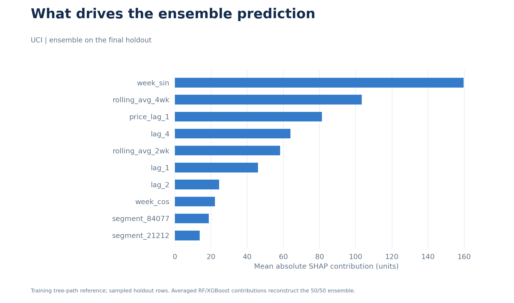
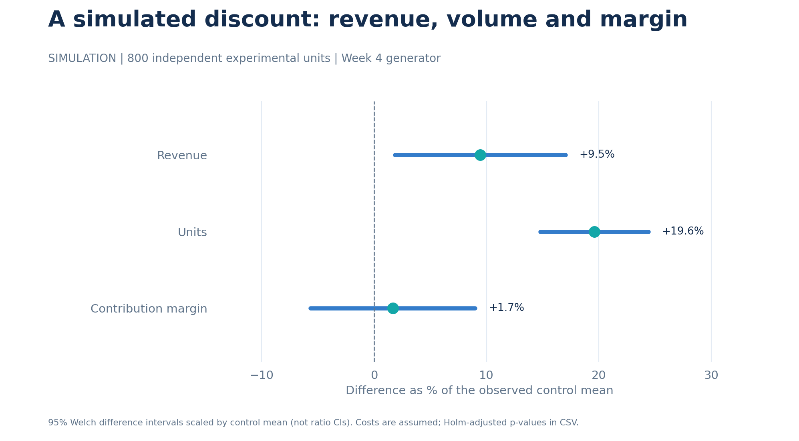
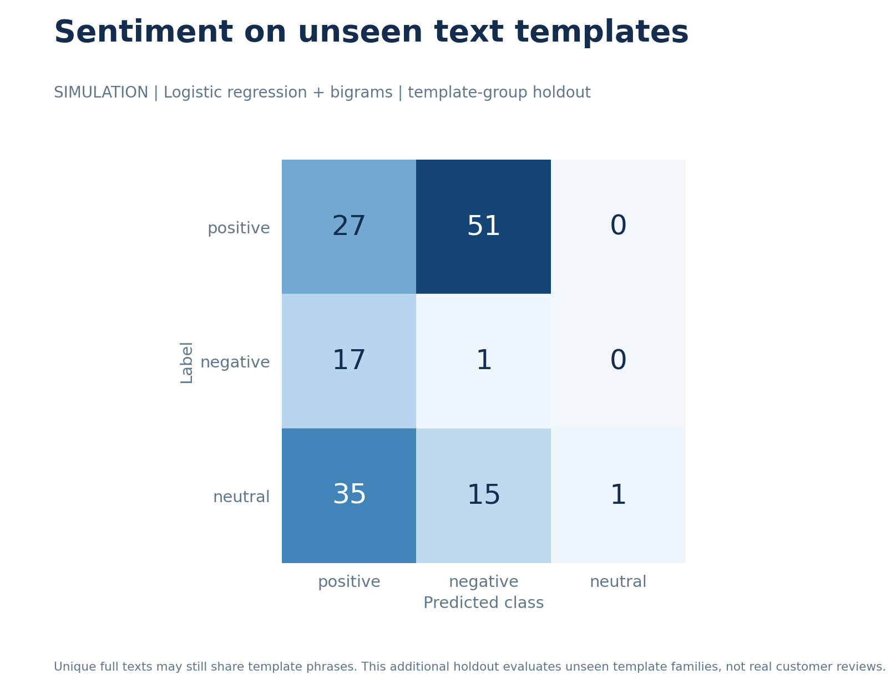

# Market Insights & Forecasting

**Retail sales, forecasting, pricing and consumer feedback - built by Gustavo.**

This repository started as a small SQL demo. I expanded it to answer a more useful question: **what evidence would I need before recommending an inventory, pricing or model decision?**

The main analysis uses actual [UCI Online Retail II](https://archive.ics.uci.edu/dataset/502/online+retail+ii) transactions. I integrated the methods from my four-week analytics exercises: quality, forecasting, model comparison, SHAP, pricing and NLP. Pricing and feedback are clearly labelled **independent simulations**, with no invented link to the retailer.

Python · SQL / DuckDB · pandas · scikit-learn · XGBoost · SHAP · SciPy · Matplotlib

## What I found

| Question | Evidence from the recorded run |
|---|---|
| Which sales can I analyze? | 1,003,214 paid positive product lines retained from 1,067,371 original rows, with every exclusion counted |
| Does ML improve the next-week forecast? | The last-week baseline has lower MAE than RF, XGBoost and their fixed average |
| Does a discount improve margin? | Simulated revenue and volume increase, but the margin interval includes zero |
| Does random-split sentiment accuracy generalize? | Bigram logistic regression achieves 92.3% on the random split but only 19.7% on unseen template families |

## Real sales and forecasting

The source is one UK-based online giftware retailer, **December 2009 to December 2011**, with prices in **GBP**. The forecasting panel contains **12 UK SKUs selected using training volume**, across **104 complete weeks**. The final **16-week holdout begins 15 August 2011**.

The target is positive paid units sold; returns/cancellations are excluded and audited. Recorded sales do not identify unconstrained demand or stock availability. A one-week forecast uses observed previous weeks, including already observed holdout weeks; it does not predict the whole holdout from a single date.



| Model | MAE, units ↓ | R² | WAPE ↓ |
|---|---:|---:|---:|
| Last-week baseline | 408.45 | -0.096 | 66.6% |
| Random Forest | 454.03 | -0.020 | 74.0% |
| XGBoost | 517.54 | -0.409 | 84.3% |
| Ensemble (50/50) | 479.40 | -0.168 | 78.1% |

**My decision:** this test does not justify deploying the ensemble as an improvement over the last-week baseline. Negative R² and weaker model results remain visible. I would investigate series stability and inventory availability before recommending additional model complexity.

The comparison includes three earlier temporal validation folds and training-only imputation, encoding and thresholds. Parameters and 50/50 weights are fixed before final evaluation. [Calculated scores](reports/metrics/forecast_scores.csv) · [Predictions](reports/metrics/forecast_predictions.csv) · [Model cards](docs/model_cards.md).





SHAP uses each tree model's training-path reference. Averaged contributions and base values reconstruct the ensemble; the [additivity audit](reports/metrics/shap_additivity.csv) is exported.



## Pricing and NLP simulations

**Pricing:** 800 independent generated experimental units, an 8% discount and assumed costs. Welch intervals and Holm correction distinguish revenue, units and contribution margin. The scenario does not establish a margin increase or a real retailer profit impact.



**NLP:** 650 bilingual template-generated reviews, with synthetic labels. Unique complete texts can share phrases, so I also hold out entire template families. The large performance decline prevents claiming readiness for human-labelled real reviews.



Shared country/category names do not justify joining these simulations to the real sales. See the [data card](docs/data_card.md) for sources, field definitions, seeds and assumptions.

## Folder structure

| Path | Purpose |
|---|---|
| data/raw/ | Public download and verified cache; ignored by Git |
| data/processed/ | Recreated panels, scenarios and DuckDB; ignored by Git |
| data/samples/ | Attributed 300-row UCI excerpt and original 30-row demo |
| notebooks/01_data_quality.ipynb | Ingestion, quality, SQL and exploration |
| notebooks/02_demand_forecasting.ipynb | Baselines, temporal evaluation and SHAP |
| notebooks/03_pricing_experiments.ipynb | Simulated pricing and contribution margin |
| notebooks/04_consumer_sentiment.ipynb | Simulated feedback and unseen-template evaluation |
| src/market_insights/ | Shared code used by notebooks and CLI |
| sql/ | Five queries with correct weekday/hour semantics |
| reports/figures/ | Exported charts with source and scope |
| reports/metrics/ | Scores, predictions, tests and run provenance |
| docs/ | Data card, model cards, decisions and usage |
| tests/ | Contracts, temporal integrity, SQL and pipeline smoke test |
| .github/workflows/ci.yml | Python 3.11/3.12 checks |
| .devcontainer/ | Codespaces environment |
| main.py · pyproject.toml · requirements.txt | Entry point, package and dependencies |

## Run in Codespaces

Open **Code → Codespaces → Create codespace**. The dev container installs notebook and SHAP dependencies. Then:

```bash
python main.py --source real --explain
python -m pytest
```

For another Python environment, from the repository root:

```bash
python -m pip install -r requirements-dev.txt
python main.py --source real --explain
```

To use only the original weekly demand simulation without downloading UCI:

```bash
python main.py --source demo --explain
```

Demo outputs remain separate, under **reports/demo/**. The first real run reads the two-year workbook; subsequent runs verify and reuse a cache. Notebook 01 prepares the panel used by 02; pricing and sentiment can also run independently. [Detailed usage and Databricks notes](docs/usage.md).

## Verification and sources

The full real and demo pipelines were executed, including SHAP. The **14 automated tests** cover cleaning, time features, SQL dates/hours, pricing joins, unseen-template vocabulary and an end-to-end demo run.

My next investigations are forecast stability, inventory availability and real human-labelled text. These are future steps, not claimed business impacts. [Decisions I can explain in an interview](docs/decisions.md).

**Attribution:** Daqing Chen, *Online Retail II*, UCI Machine Learning Repository, [DOI 10.24432/C5CG6D](https://doi.org/10.24432/C5CG6D). Data and the bundled excerpt: [CC BY 4.0](https://creativecommons.org/licenses/by/4.0/). Project code: [MIT](LICENSE).

[GitHub profile](https://github.com/gusbakers) · Master's in Data Science
